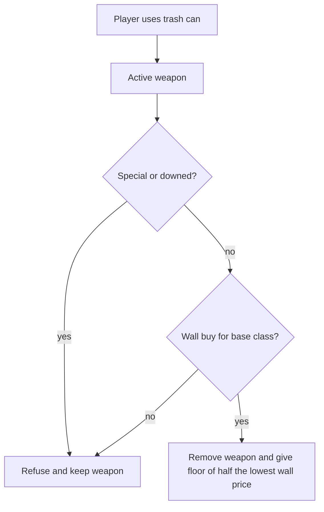

# Multitool weapon recycler

Wall-buy price is the only value. If the held gun’s base class is not on any `wall_buys` on the map, the recycler refuses it. Pack-a-Punch refunds half the base wall price; the 5000 upgrade cost is not refunded. Mystery-box price is not used.

## Placement

Same multitool flow as zombie spawns (LMB place, RMB remove, saved with the map config), using the perk-machine spawn shape because the recycler is a visible prop that needs a facing angle.

- New tool `recycler` in [`sh_tools_recycler.lua`](garrysmod/addons/nzombies-chronicles/gamemodes/nzombies_chronicles/gamemode/tools/sh_tools_recycler.lua), registered with `nzTools:CreateTool` (auto-loaded via the `sh_` prefix).
- LMB calls `nzMapping:Recycler(tr.HitPos, Angle(0, (ply:GetPos() - tr.HitPos):Angle()[2], 0), ply)` — same yaw-toward-placer as [`sh_tools_perk.lua`](garrysmod/addons/nzombies-chronicles/gamemodes/nzombies_chronicles/gamemode/tools/sh_tools_perk.lua).
- RMB removes a placed recycler (`prop_physics` marked as a weapon recycler). No tool options (nothing to configure per can).
- [`sv_mapping.lua`](garrysmod/addons/nzombies-chronicles/gamemodes/nzombies_chronicles/gamemode/mapping/sv_mapping.lua): spawn GMod’s default **`prop_physics`** with model `models/props_junk/TrashBin01a.mdl` (same as Sandbox construction spawnlist), freeze physics, mark the ent as a recycler (e.g. networked flag), `SetUseType(SIMPLE_USE)`, undo entry (same pattern as `nzMapping:PerkMachine`).
- [`sv_savemodules.lua`](garrysmod/addons/nzombies-chronicles/gamemodes/nzombies_chronicles/gamemode/mapping/sv_savemodules.lua): module `RecyclerSpawns` stores `{ pos, angle }` and reloads through `nzMapping:Recycler`. Old configs simply have no key, so no config version bump.

## World prop (no custom SENT)

Use the stock **`prop_physics`** entity — not a new `nz_recycler` scripted class. That matches what Sandbox spawns for the trash-bin model and keeps the can a normal frozen prop.

- Model: `models/props_junk/TrashBin01a.mdl`.
- After spawn: freeze physics, solid, visible in gameplay (not creative-only, unlike zombie spawn markers).
- Mark placed cans so multitool remove, save/load, prompts, and use handling only target mapper-placed recyclers (not every trash prop on the map).
- Recycle logic lives in gamemode code (e.g. shared helpers + `PlayerUse` hook), with the same wall-buy 1 second `activator.nextUseTime` cooldown as wall buys — `prop_physics` has no `ENT:Use` script.

## Recycle rules

On use, server-side:

1. Require `activator:GetNotDowned()` and a valid `GetActiveWeapon()`.
2. Refuse if `wep:IsSpecial()` (knife, grenade, perk bottle, shield, death machine, and other specials).
3. Resolve the base class: `nzWeps:Unreplaced(class).ClassName` when the gun is Pack-a-Punched, otherwise `wep:GetClass()`.
4. Scan `ents.FindByClass("wall_buys")` and take the **lowest** `tonumber` price whose `WeaponGive` / `GetWepClass()` equals that base class. Two walls for the same gun cannot be farmed by recycling against the expensive one.
5. If none match, or the refund `math.floor(price / 2)` is below 1, refuse and leave the weapon. Chat: the weapon cannot be recycled.
6. On success: `wep:Remove()`, then `activator:GivePoints(refund, true)` so Double Points does not double the refund. The existing points popup is the success feedback. Other guns and the knife stay.

## Look prompt

In [`cl_target.lua`](gamemodes/nzombies_chronicles/gamemode/display/cl_target.lua) `nzTarget.TraceEnts`, handle marked `prop_physics` recyclers the same style as wall buys. Client scans wall buys for the active weapon’s base class and shows either “Press USE to recycle [name] for [points]” or “Cannot recycle this weapon.”
